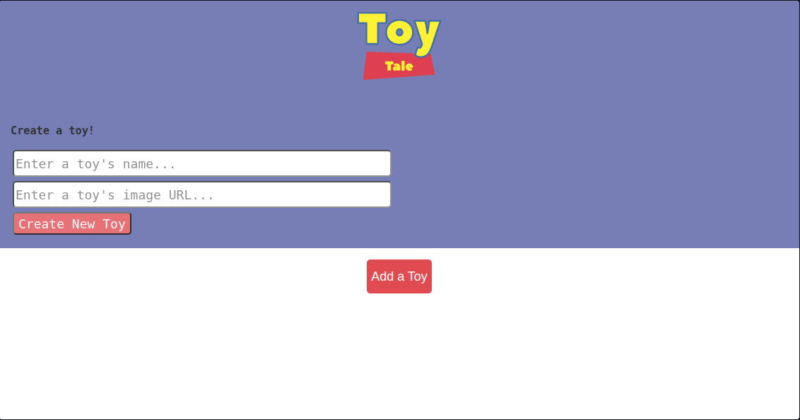

# Toy Tales

A React application for managing a collection of toys. Users can view existing toys, add new toys via a controlled form, increment toy likes, and donate toys to remove them from the collection.

## Screenshot



## Features

- **View Toys (`GET`):** Fetches and displays all toys from the local JSON server on initial page load.
- **Add a Toy (`POST`):** Allows users to submit a form with a toy's name and image URL to create a new toy card.
- **Like a Toy (`PATCH`):** Increments a toy's like count and persists the update to the backend.
- **Donate a Toy (`DELETE`):** Removes a toy from both the UI and the backend database.

## Technologies Used

- React (`useState`, `useEffect`)
- Vite
- JSON Server (REST API)
- JavaScript (ES6+ Fetch API)

## Getting Started

1. Clone the repository:
   ```bash
   git clone https://github.com
   ```
2. Install dependencies:
   ```bash
   npm install
   ```
3. Start the JSON server backend:
   ```bash
   npm run server
   ```
4. In a new terminal, start the React development server:
   ```bash
   npm run dev
   ```